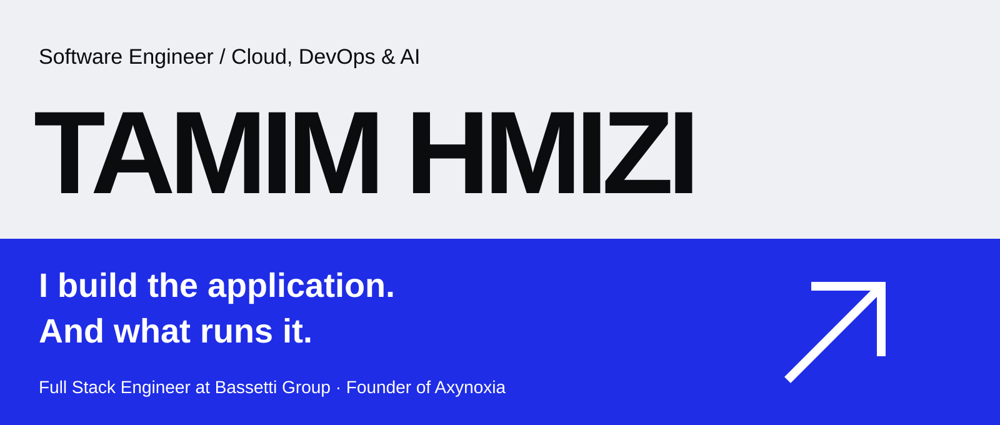
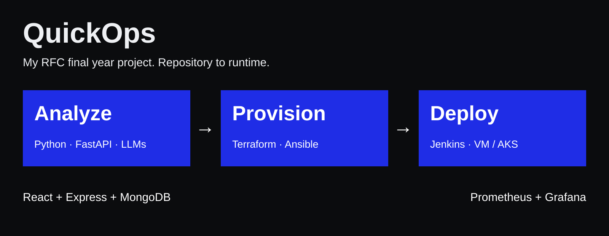
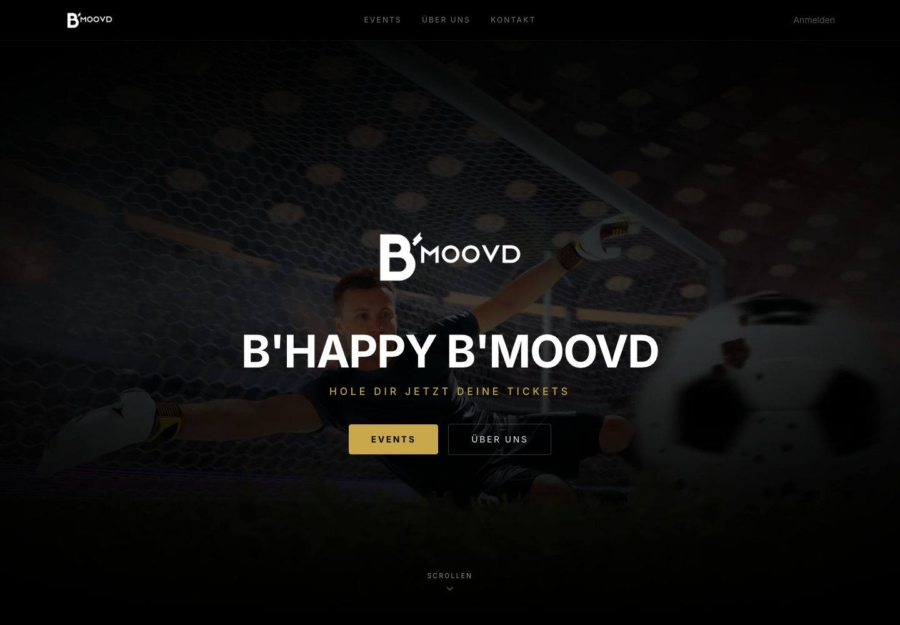
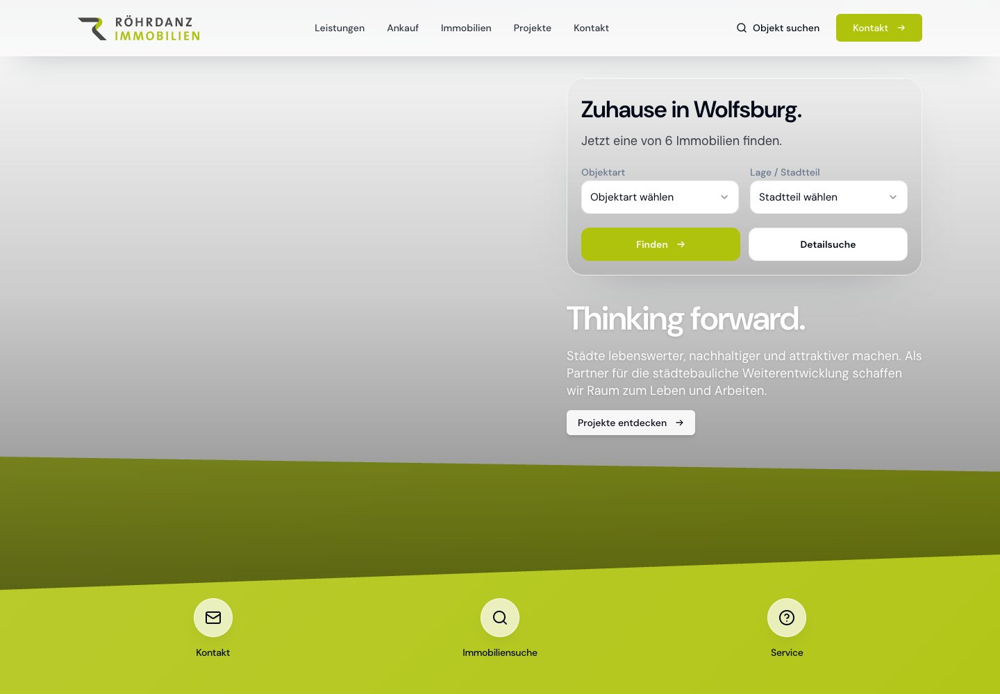

[Explore my portfolio ↗](https://tamim-hmizi.github.io/Portfolio/) · [Resume (EN)](https://tamim-hmizi.github.io/Portfolio/resume-en.pdf) · [CV (FR)](https://tamim-hmizi.github.io/Portfolio/cv-fr.pdf) · [LinkedIn](https://www.linkedin.com/in/tamimhmizi/)

I like building across the boundaries: the interface, the API, the deployment pipeline and the infrastructure underneath. My applied AI work connects language models to repository analysis and deployment recommendations.

Full Stack Engineer at **Bassetti Group**. Founder of **[Axynoxia](https://www.axynoxia.com)**.

## One project. The whole stack.

**QuickOps** is my RFC final year project: a platform that analyzes application repositories, recommends VM or Kubernetes deployment and connects those recommendations to automated provisioning and delivery.

Explore the implementation: [AI service](https://github.com/tamim-hmizi/QuickOps-AI) · [Interface](https://github.com/tamim-hmizi/QuickOps-Frontend) · [Platform API](https://github.com/tamim-hmizi/QuickOps-Backend) · [Infrastructure](https://github.com/tamim-hmizi/QuickOps-IAC) · [Configuration](https://github.com/tamim-hmizi/QuickOps-CAC)

## From code to something people use

 

**[B'moovd Ticketing](https://bmoovd-shop.com/)** brings checkout, signed QR tickets, PDF delivery and camera check-in together. Next.js, tRPC, Prisma and MongoDB.

**[Roehrdanz Immobilien](https://rimmobilien-test.de/)** combines property listings and enquiries with an employee CMS, image processing and access control. React, Express and MongoDB.

<strong>More selected work</strong>

- **Azure Stack Hub Monitoring:** Python/Flask exporters, service principal OAuth2, Prometheus and Grafana dashboards for infrastructure and tenant VMs. RFC infrastructure work.
- **[B'moovd Mobile](https://apps.apple.com/de/app/bmoovd/id6736364332):** published Flutter app with Firebase Auth, Firestore, Cloud Functions and store release pipelines.
- **[Axynoxia ERP](https://erp.products.axynoxia.com/):** modular NestJS and PostgreSQL application with dedicated client deployments, access control and module discovery. Ongoing product development.
- **[Axynoxia Energie](https://energie.products.axynoxia.com/):** TypeScript services and a plant simulator for solar/battery telemetry, alarms and HMI supervisory control.
- **[Confortex](https://confortex.shop/):** custom Shopify storefront with collections, editorial content and showroom discovery.

## What I bring to the build

**Software** / TypeScript, Python, C#, Java, PHP, SQL; React, Next.js, Angular, Flutter, .NET, Node.js, NestJS, Express, FastAPI, Spring Boot and Symfony.

**Cloud & delivery** / Azure, Azure Stack Hub, AWS, AKS, EKS and OpenStack; Docker, Kubernetes, Terraform, Ansible, Jenkins and GitHub Actions.

**AI & operations** / LLM integration, repository analysis and Python automation; PostgreSQL, MongoDB, Redis, Prometheus, Grafana, Linux, Commvault, IAM and RBAC.

Background

Software Engineering Degree, **ESPRIT, 2020 to 2025**. Cloud Architecture and DevOps (ArcTIC).

Previously Infrastructure Consultant at RFC, following cloud, DevOps and development projects and internships at RFC, ESPRIT and Tunisie Telecom.

Arabic (native), English (B2), French (B2). Based in Ariana.

## Have something worth building?

[Engineering opportunities ↗](mailto:tamimhmizi@icloud.com) · [Client projects at Axynoxia ↗](mailto:tamim.hmizi@axynoxia.com)
