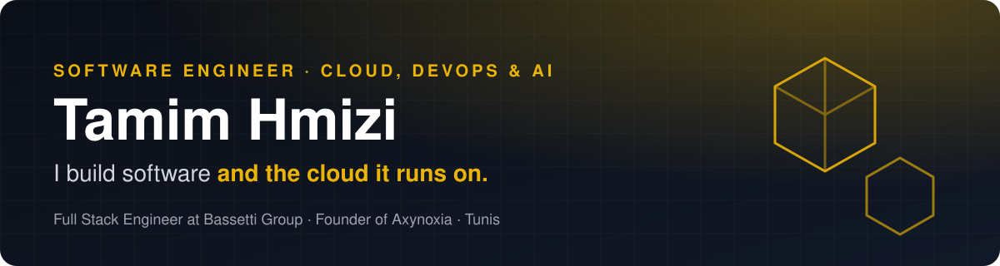

 

<a href="https://tamim-hmizi.github.io/Portfolio/resume-en.pdf"><b>English resume</b></a> · <a href="https://tamim-hmizi.github.io/Portfolio/cv-fr.pdf"><b>CV français</b></a>

## About me

I'm a software engineer who builds products **and the cloud they run on**. I'm a **Full Stack Engineer at [Bassetti Group](https://www.bassetti-group.com/)** on TEEXMA, and the **founder of [Axynoxia](https://www.axynoxia.com)**, a software engineering team that delivers custom platforms, automation and cloud setups for growing businesses.

I design, ship and operate web and mobile applications on Azure, AWS and Kubernetes, automate their delivery with infrastructure as code and CI/CD, and add LLM features where they help.

**What I do**

- **Full stack engineering:** web and mobile apps with React, Next.js, Angular, Flutter, Node.js, NestJS and .NET.
- **Cloud and DevOps:** Azure, AWS and Kubernetes, with Terraform, Ansible, CI/CD and Prometheus/Grafana monitoring.
- **AI and automation:** LLM features and workflow automation where they save real time.
- **Delivery end to end:** from scoping and architecture to production, monitoring and support.

## Tech stack

**Cloud and DevOps**

**Languages and frameworks**

**Data and tools**

Also: Azure Stack Hub, AKS, AWS EKS and IAM, OpenStack, Helm, SonarQube, Trivy, Nexus, Traefik, Caddy, ELK, Commvault, Fortinet, Shopify, Stripe and LLM integration.

## Experience

**Full Stack Engineer · [Bassetti Group](https://www.bassetti-group.com/) (TEEXMA)** · Apr 2026 to present · Tunis
- Enterprise applications for technical and scientific data management with .NET, Angular and JavaScript, used across aerospace, energy, automotive, chemicals and pharmaceuticals.
- Delphi core modules, Docker workloads and delivery automation, including Jenkins and Terraform CI.

**Founder & Software Engineer · [Axynoxia](https://www.axynoxia.com)** · Jan 2026 to present · Tunis
- Lead a team delivering fixed-scope client projects, from scoping and architecture to cloud provisioning, CI/CD and production operations.
- Client work from mobile apps to ticketing, e-commerce and real estate platforms, plus our own products running behind a shared Caddy edge proxy.

**Infrastructure Consultant · [RFC](https://rfc.com.tn) (Microsoft Gold CSP Partner)** · Oct 2025 to May 2026 · Ariana
- Hybrid cloud combining Azure Stack Hub and Azure, sovereign cloud and data residency, Fortinet SD-WAN and Cisco networking.
- Prometheus and Grafana monitoring for 2 Azure Stack Hub datacenters; Commvault backups with restore validation; workshops on cloud security and Microsoft 365 governance.

**DevOps Platform Engineer, final year project · RFC** · Feb 2025 to Aug 2025
- Built QuickOps, a DevOps as a Service platform where an LLM analyzes a repository and recommends VM or Kubernetes deployment, then Terraform, Ansible, AKS and Jenkins deliver it.

<b>Earlier roles</b>

- **Cloud & Full Stack Engineer Intern · RFC** (Jul to Aug 2024): intern management app on AWS EKS with Jenkins, Terraform, GitHub Actions, IAM and Prometheus/Grafana.
- **Web Developer Intern · ESPRIT** (Jul to Aug 2023): Python scraping and recommendation platform for online courses.
- **Network Engineer Intern · Tunisie Telecom C-NOC** (Aug to Sep 2021): B2B link monitoring and routing incidents.

## Featured projects

| Project | What it is | Stack |
|---|---|---|
| **[QuickOps](https://github.com/tamim-hmizi/QuickOps-Frontend)** | DevOps as a Service: LLM repository analysis, then automated VM or AKS deployment and monitoring. [AI](https://github.com/tamim-hmizi/QuickOps-AI) · [API](https://github.com/tamim-hmizi/QuickOps-Backend) · [IaC](https://github.com/tamim-hmizi/QuickOps-IAC) · [CaC](https://github.com/tamim-hmizi/QuickOps-CAC) | React, FastAPI, Express, Terraform, Ansible, Jenkins, AKS |
| **[bmoovd Ticketing](https://bmoovd-shop.com)** | Ticket shop for FIFA World Cup 2026 public viewing events in Wolfsburg, with signed QR tickets and camera check-in. | Next.js 14, tRPC, Prisma, Stripe, Mollie, PayPal |
| **[Axynoxia ERP](https://erp.products.axynoxia.com)** | Modular ERP for operations, finance, inventory and reporting. | NestJS, Prisma, PostgreSQL, Redis, Traefik |

<b>Client work (8)</b>

| Project | What it is | Stack |
|---|---|---|
| **bmoovd** ([App Store](https://apps.apple.com/de/app/bmoovd/id6736364332) · [Google Play](https://play.google.com/store/apps/details?id=com.bmoovd.app)) | Sports bar app: programme, table reservations and live scores. | Flutter, Firebase, Stripe |
| **[Roehrdanz Immobilien](https://rimmobilien-test.de/)** (preview) | Bilingual real estate platform with listings, filters and agent enquiries. | React, Express, MongoDB |
| **[Habiter Mieux](https://habiter-mieux.info/)** | Solar lead generation site with a qualification funnel. | React |
| **[Confortex](https://confortex.shop/)** | Custom Shopify theme for a bedding brand. | Shopify |
| **[Vie Sublime](https://www.viesublime.tn/)** | Custom Shopify theme for a furniture brand. | Shopify |
| **[Digiqora Media](https://digiqoramedia.com)** | Content agency site, fast on mobile with click-to-load video. | Astro, Tailwind, GSAP, Cloudflare Pages |
| **[OMHY Entertainment](https://omhyfamily.com/)** | Media platform for artists, albums, casting and news. | React, Express, MongoDB, Jenkins |
| **bmoovd Ticketing** | See featured projects. | |

<b>Axynoxia products (7)</b>

| Product | What it is | Stack |
|---|---|---|
| **[Axynoxia Energie](https://energie.products.axynoxia.com)** | EMS and SCADA/HMI for hybrid solar and battery plants. | TypeScript, React |
| **[Axynoxia GymOS](https://gymos.products.axynoxia.com)** | Multi-tenant gym management SaaS with member portal and kiosk. | Next.js, TypeScript |
| **[Axynoxia Tickets](https://tickets.products.axynoxia.com)** | Event ticketing with QR entry control and Konnect payment. | React, TypeScript, Docker |
| **[Axynoxia CRM Leasing](https://crm-leasing.products.axynoxia.com)** | CRM and lease contracts with IFRS 16 calculations and Arabic RTL. | MERN |
| **[Axynoxia Invoice](https://invoice.products.axynoxia.com)** | Multi-currency invoicing with 2FA and PDF/Excel export. | React, Express, MongoDB |
| **[Axynoxia Website](https://www.axynoxia.com)** | Company site with 3D visuals and a blog. | Astro, React, Three.js, Cloudflare Workers |
| **Axynoxia ERP** | See featured projects. | |

<b>Cloud, DevOps and other work (8)</b>

| Project | What it is | Stack |
|---|---|---|
| **Enterprise Monitoring Platform** (RFC) | Azure Stack Hub monitoring for 2 datacenters with dashboards and alerts. | Python, Prometheus, Grafana, Docker |
| **Axynoxia Edge Proxy** | Shared reverse proxy and TLS for every Axynoxia project on one VPS. | Caddy, Docker Compose |
| **DevOps CI/CD Hub** (ESPRIT) | Pipelines for Angular and Spring Boot microservices. | Jenkins, SonarQube, Trivy, Nexus |
| **OpenStack Private Cloud Lab** (ESPRIT) | Multi-node private cloud with networking, storage and HA. | OpenStack |
| **[MERN E-commerce](https://github.com/tamim-hmizi/EcommerceShop-Frontend)** | Storefront and API in monolithic and microservice variants, used to validate QuickOps. | React, Redux, Express, MongoDB |
| **New Journey** | Immigration consulting application. | Symfony 7, PHP, Docker Compose |
| **Espro** (ESPRIT) | Teacher management system. | Angular, Spring Boot |
| **Bon Livraison** | Delivery note management. | React, Express |

## Education and languages

**Software Engineering Degree, ESPRIT** (2020 to 2025): specialization in Cloud Architecture and DevOps (ArcTIC).

Arabic (native) · English (C1) · French (B2)

 

**Have something to build, scale or fix?** [Email me](mailto:tamimhmizi@icloud.com) or [book a call](https://calendly.com/axynoxia/axynoxia-discovery-call).

