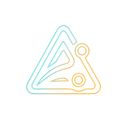
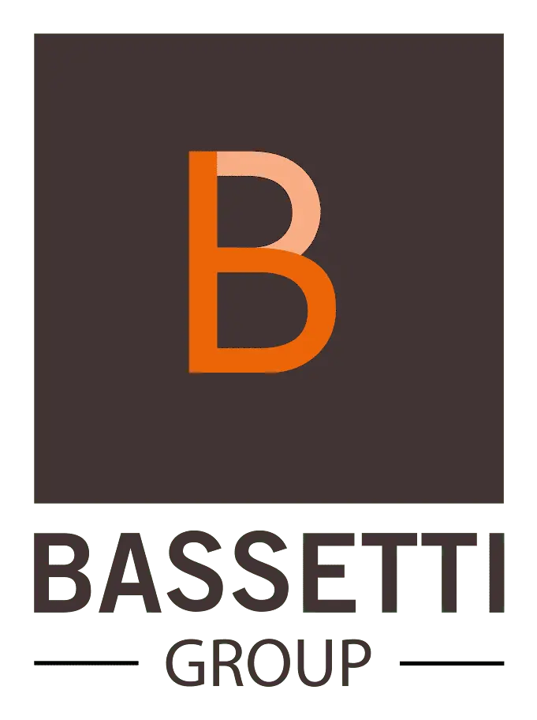
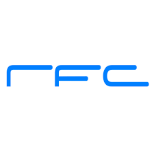
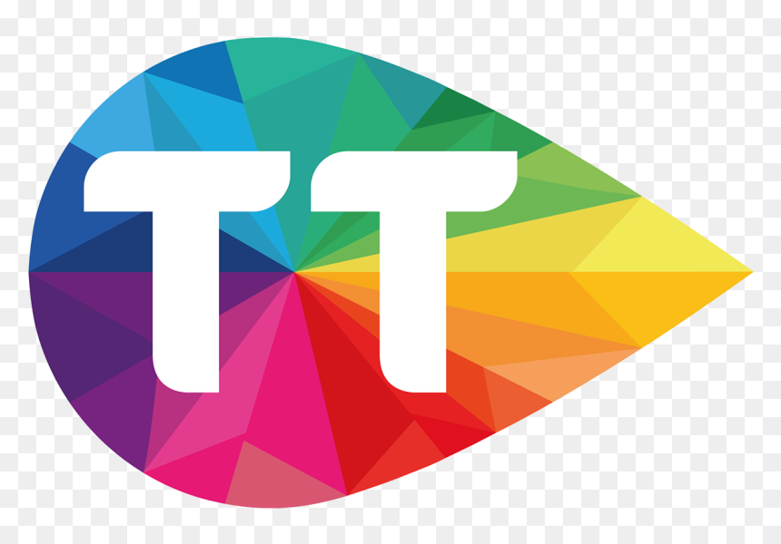

# 👋 Hi, I'm Tamim Hmizi

**Software Engineer | Cloud, DevOps & AI** • Founder of [Axynoxia](https://axynoxia.com)

*I design, build and run software end to end: products and the cloud infrastructure underneath them.*

---

## 💼 What I Do

I run **[Axynoxia](https://axynoxia.com)**: a software engineering company delivering custom software,
cloud & DevOps, AI and intelligent automation, integrations, and e-commerce for growing businesses.

- 🏗️ **Custom software**: web platforms, mobile apps, multi-tenant SaaS, ERP, ticketing
- ☁️ **Cloud & DevOps**: architecture, IaC, CI/CD, containers, observability, security
- 🤖 **AI & automation**: LLM-driven analysis, intelligent workflows
- 🛒 **E-commerce & integrations**: Shopify storefronts, payments, third-party systems

I own delivery end to end: architecture, full-stack build, production deployment, and the infrastructure it runs on.

📅 **[Book a call](https://calendly.com/axynoxia/axynoxia-discovery-call)**

---

## 👤 Professional Profile

Software engineer and **founder of Axynoxia**, combining full stack development, cloud infrastructure and applied AI. I build web and mobile applications, automate deployments and operate their infrastructure. Currently also a **Full Stack Engineer at Bassetti Group**, working on TEEXMA.

My **QuickOps** final year project connects LLM repository analysis with Terraform, Ansible, Jenkins and Kubernetes deployment. Earlier RFC work covers Azure Stack Hub, hybrid cloud operations, observability and backup.

Working languages: **Arabic, French, English**.

📄 **[English résumé](https://tamim-hmizi.github.io/Portfolio/resume-en.pdf)** · **[CV français](https://tamim-hmizi.github.io/Portfolio/cv-fr.pdf)**

---

## 🛠️ Core Technical Skills

### ☁️ Cloud & Platforms

---

### 🐳 Containers & Orchestration

---

### 🔧 DevOps & Automation

---

### 📊 Monitoring & Observability

---

### 🔒 Security & Quality

---

### 💾 Backup & Storage

-1B1F23?style=for-the-badge&logo=sonatype&logoColor=white)

---

### 🖥️ Systems & Identity

---

### 💻 Programming Languages

---

### ⚙️ Backend Frameworks

---

### 🌐 Frontend Frameworks

---

### 💾 Databases & ORMs

---

### 📝 Version Control

---

## 💼 Professional Experience

<b>🚀 Founder & Software Engineer: Axynoxia</b> • <i>Jan 2026 to Present</i> • <i>Tunis, Tunisia</i>

- Founded and run a **software engineering company** serving growing businesses: custom software, cloud & DevOps, AI and intelligent automation, integrations, and e-commerce.
- **Own the full delivery lifecycle** on every engagement: scoping, architecture, full-stack implementation, cloud provisioning, CI/CD, observability, and production operations.
- Shipped and operate production systems: a **ticketing platform**, a **Flutter app live on the App Store and Google Play**, a **real estate CMS**, and **Shopify storefronts**.
- Developing internal business applications with hosted demos, including a modular ERP and ticketing platform, using **NestJS**, **Prisma**, **PostgreSQL**, **Redis**, **React** and **Traefik**.
- Handle client relationships, technical scoping, and commercial delivery directly.

<b>🏢 Full Stack Engineer: Bassetti Group (TEEXMA)</b> • <i>Apr 2026 to Present</i> • <i>Tunis, Tunisia</i>

- Full stack development on enterprise applications using **.NET**, **Angular**, **JavaScript**, **HTML**, and **CSS** on the **TEEXMA** platform: a collaborative no-code solution for technical and scientific data management.
- Maintenance and extension of **legacy Delphi modules** constituting the central processing engine of TEEXMA.
- Containerizing application workloads with **Docker** and contributing to **DevOps** automation workflows.
- Contribute to enterprise software for aerospace, energy, automotive, chemical and pharmaceutical data management.

<b>🏢 Infrastructure Consultant: RFC (Microsoft Gold CSP Partner)</b> • <i>Oct 2025 to May 2026</i> • <i>Ariana, Tunisia</i>

- Designed and optimized **production hybrid cloud infrastructures** for a major Microsoft Cloud Solution Provider (CSP), integrating **Azure Stack Hub** with public Azure services.
- Architected **sovereign cloud environments** for enterprise clients, supporting data residency requirements and hybrid cloud architectures.
- Orchestrated enterprise-scale security and networking with **Fortinet SD-WAN** and **Cisco** logic to protect multi-tenant infrastructure.
- Administered critical backup operations with **Commvault**, implementing automated restore validation and incident analysis reporting.
- Automated recurring tasks and security patches across **Linux** and **Windows Server** fleets.
- Delivered high-level technical workshops as an **Infrastructure Subject Matter Expert (SME)**, guiding clients on cloud-native security and Microsoft 365 governance.
- Managed **Active Directory** services and participated in **Microsoft 365** tenant administration.
- Implemented endpoint and server protection using **Trend Micro** across infrastructure environments.

<b>🎓 DevOps Platform Engineer: Final Year Project (PFE), RFC</b> • <i>Feb 2025 to Aug 2025</i>

- Designed and implemented a **DevOps-as-a-Service SaaS platform** to automate application analysis, deployment, and monitoring.
- Built a **monolithic core application** using **React**, **Express.js**, **FastAPI**, and **MongoDB**, with separation between frontend, API gateway, and backend services.
- Integrated an **AI-driven analysis engine (LLM-based)** to inspect Git repositories, application structure, dependencies, and runtime requirements.
- Implemented **multi-architecture deployment logic** (VM for monolith/one-tier, AKS for microservices).
- Developed **two MERN e-commerce applications** as real deployment use cases (VM monolith + AKS microservices backend).
- Automated **VM deployments** using **Terraform**, **Ansible**, and **Docker / Docker Compose**.
- Implemented **AKS microservices deployments** using **AKS Engine**, **kubectl**, and Kubernetes **YAML manifests**.
- Designed and implemented **CI/CD pipelines using Jenkins** covering build, test, quality, security, artifacts, and deployment.
- Integrated **SonarQube** (quality) and **Nexus** (artifacts).
- Implemented **observability** using **Prometheus** and **Grafana**.

<b>💻 Cloud & Full Stack Engineer: Internship, RFC</b> • <i>Jul 2024 to Aug 2024</i>

- Developed a **cloud-native web application** for the **management of interns** (onboarding, tracking, admin workflows).
- Deployed on **AWS EKS (Kubernetes)** using a fully containerized architecture.
- Built end-to-end **CI/CD** using **Jenkins**, **Docker**, **Terraform**, and **GitHub Actions**.
- Implemented **IAM security controls** and monitoring using **Prometheus** and **Grafana**.

<b>🌐 Web Developer: Internship, ESPRIT</b> • <i>Jul 2023 to Aug 2023</i>

- Designed and developed a platform scraping **official educational websites** to collect and aggregate online courses.
- Implemented **Python web scraping** to extract metadata (title, provider, duration, difficulty).
- Normalized and stored data in a structured database for efficient search and filtering.
- Built backend services to rank and recommend the **best courses** based on user criteria.
- Built a responsive web interface for search, compare, and discovery.
- Ensured reliability by targeting only **official and verified** providers.

<b>🌐 Network Engineer Intern (C-NOC): Tunisie Telecom</b> • <i>Aug 2021 to Sep 2021</i>

- Worked in the national B2B Network Operations Center.
- Monitored enterprise network links and handled connectivity incidents.
- Assisted in troubleshooting routing and service availability issues.

---

## 🚀 Projects

Client deliveries, RFC and ESPRIT projects, independent work and products in development. Expand a project for its engineering scope. Hosted product demos are labeled in their descriptions.

<b>QuickOps</b> · <a href="https://github.com/tamim-hmizi/QuickOps-Frontend">Frontend</a> · <a href="https://github.com/tamim-hmizi/QuickOps-AI">AI service</a> · <a href="https://github.com/tamim-hmizi/QuickOps-Backend">Backend</a> · <a href="https://github.com/tamim-hmizi/QuickOps-IAC">Infrastructure</a> · <a href="https://github.com/tamim-hmizi/QuickOps-CAC">Configuration</a>

RFC final year platform combining React, Express, FastAPI and MongoDB. LLM repository analysis recommends VM or Kubernetes deployment, connected to Terraform, Ansible, Jenkins, AKS and monitoring.

<b>B-moovd Ticketing</b> · <a href="https://bmoovd-shop.com">Website / demo</a>

Next.js/tRPC ticket shop with MongoDB/Prisma, Stripe, Mollie and PayPal checkout, signed QR tickets, camera check-in, emailed PDFs and role based authentication.

<b>B-moovd</b> · <a href="https://apps.apple.com/de/app/bmoovd/id6736364332">App Store</a> · <a href="https://play.google.com/store/apps/details?id=com.bmoovd.app">Google Play</a>

Published Flutter/Dart app for iOS and Android with Firebase Auth, Firestore, Cloud Functions, Storage, Stripe integration and store release pipelines.

<b>Roehrdanz Immobilien</b> · <a href="https://rimmobilien-test.de/">Website / demo</a>

React, Express and MongoDB property CMS with listings, enquiries, employee sessions, RBAC, asynchronous image processing and dynamic SEO content.

<b>Confortex</b> · <a href="https://confortex.shop">Website / demo</a>

Custom Shopify bedding storefront with product collections, SEO editorial content, newsletter integration, delivery promotions and showroom information.

<b>Vie Sublime</b> · <a href="https://viesublime.tn">Website / demo</a>

Custom Shopify furniture storefront with collections for home, office, school and garden, editorial content, newsletter integration and showroom information.

<b>OMHY Entertainment</b> · <a href="https://omhyfamily.com">Website / demo</a>

React media and administration application for artists, groups, albums, songs, casting submissions, news and newsletter management; Express/MongoDB backend and delivery configuration.

<b>Habiter Mieux</b> · <a href="https://habiter-mieux.info/">Website / demo</a>

Solar installation website with service and subsidy information, search optimization and a quote-request funnel connected to the client sales workflow.

<b>Axynoxia Energie</b> · <a href="https://energie.products.axynoxia.com">Website / demo</a>

TypeScript domain, API, control, HMI and simulation services modeled on the ADAM plant design. Solar/battery telemetry, alarms and supervisory control in a hosted demo; not safety instrumentation.

<b>ProInvoice</b> · <a href="https://invoice.products.axynoxia.com">Website / demo</a>

React/Vite and Express/TypeScript invoicing application with MongoDB, two factor authentication, PDF/Excel export, transactional email and Swagger API documentation. Hosted product demo.

<b>Axynoxia LeadGen</b>

B2B prospecting project in development using NestJS/Next.js, Temporal and LangGraph, with enrichment, email verification, provenance, provider logs, credit billing, suppression and consent workflows.

<b>Axynoxia CRM & Leasing</b> · <a href="https://crm-leasing.products.axynoxia.com">Website / demo</a>

MERN lease-management application with IFRS 16/BCT oriented calculations, 10-role RBAC, Arabic RTL, background jobs and containerized deployment. Hosted product demo.

<b>Enterprise Monitoring Platform</b>

RFC Azure Stack Hub monitoring with Dockerized Python/Flask exporters, Admin APIs, OAuth2 service principal authentication, Prometheus/Grafana metrics, dashboards and alerts for infrastructure and tenant VMs.

<b>Axynoxia ERP</b> · <a href="https://erp.products.axynoxia.com">Website / demo</a>

NestJS, Prisma, PostgreSQL and Redis modular business application with dedicated client deployments, module discovery, MFA, RBAC, access requests, Docker Compose and Traefik. Ongoing development and hosted demo.

<b>Tickety</b> · <a href="https://tickets.products.axynoxia.com">Website / demo</a>

React/Vite and TypeScript ticketing application with authentication, cookie sessions, checkout, pending-order expiry, concurrent refund handling, end to end smoke tests and Docker deployment. Hosted demo.

<b>MERN E-commerce</b>

React/Redux storefront and Express/MongoDB API with authentication, cart, favorites, categories, orders, inventory administration, uploads and metrics. Monolithic and microservice variants support deployment examples.

<b>New Journey</b>

Symfony/PHP consulting application with consultation booking and date lookup, administration, Doctrine persistence, authentication and Docker Compose configuration.

<b>DevOps CI/CD Hub</b>

ESPRIT Jenkins pipelines for Angular and Spring Boot applications, integrating SonarQube quality gates, Trivy scanning and Nexus artifact versioning.

<b>OpenStack Private Cloud Lab</b>

ESPRIT multi-node OpenStack lab with virtual networks, subnets, compute, storage, VPN connectivity and workload lifecycle, scaling and high availability exercises.

---

## 🎓 Education

**Software Engineering Degree** | ESPRIT: Ariana, Tunisia
*2020 to 2025*
3 years General Software Engineering | 2 years Specialty: **ArcTIC: Cloud Architecture and DevOps**

---

## 🌍 Languages

---

### 💬 Let's build something

